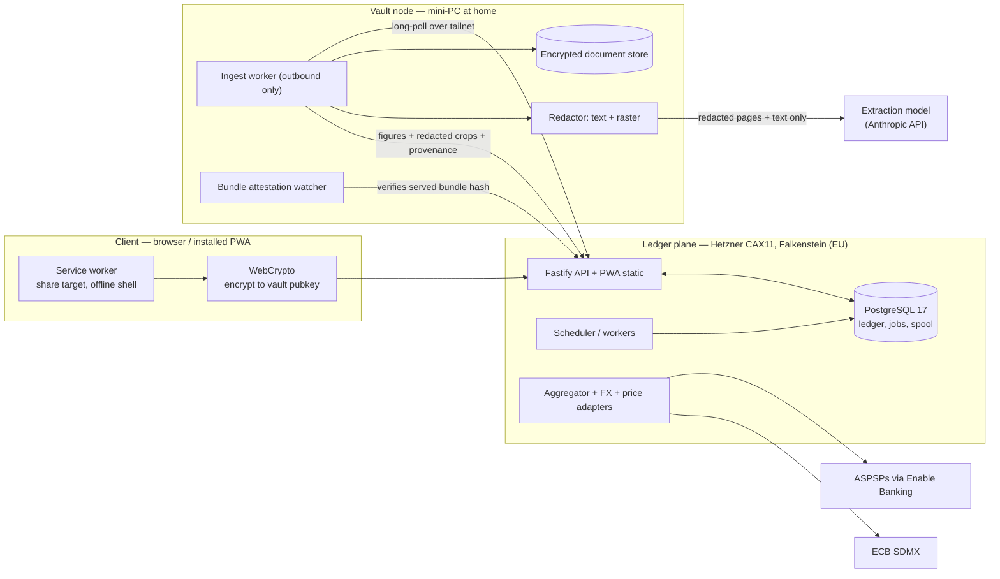
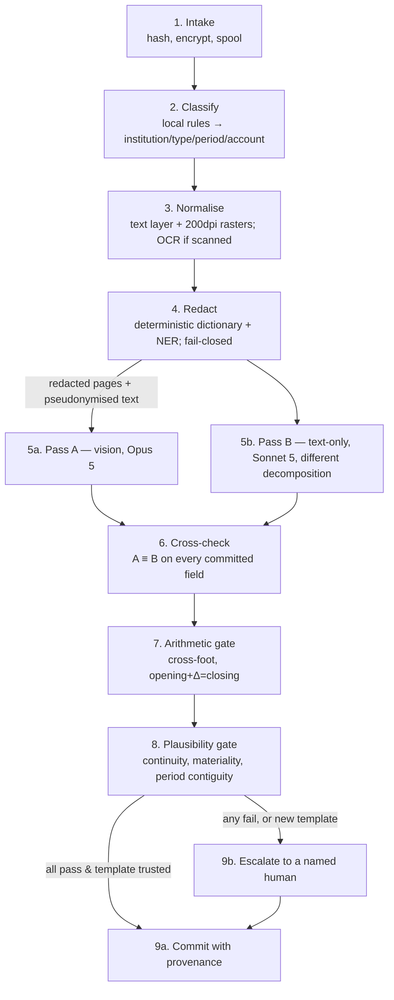

# Architecture

**Agent:** Architecture
**Owns:** System shape, aggregator adapter boundary, ingestion pipeline, deployment topology, resilience with all feeds down
**Status:** Design. Binding inputs are `01-feasibility-assessment.md` and `02-decisions-and-constraints.md`.
**Date:** 27 August 2026

---

## 0. Summary

The system is a **ledger with four interchangeable ways of getting numbers into it**, not an aggregator
with a manual fallback. Live feeds, file imports, extracted documents and manual entry all produce the
same internal artifact — an `Observation` carrying provenance and a freshness policy — and travel the
same code path from there. That single decision is what makes INV5 structural rather than aspirational:
when the four live accounts lose their feed, they do not fall out of the system, they fall one rung down
a ladder that 22 other account lines already stand on.

Deployment is **two planes plus the client**:

| Plane | Where | Holds | Always on |
|---|---|---|---|
| **Ledger plane** | Managed EU VPS (Hetzner Falkenstein) | Postgres ledger, API, PWA, scheduler, aggregator adapters | Yes |
| **Vault node** | Fanless mini-PC in the house | Original documents, redaction, extraction egress, decryption key | Best effort |
| **Client** | Browser / installed PWA on Android and desktop | Offline read model, upload outbox, client-side encryption | N/A |

D1 and INV8 require that unredacted document content never leaves infrastructure the household
controls. The reconciliation with managed hosting is that **the trust boundary is drawn at key custody,
not at the datacentre fence**: the browser encrypts every uploaded file to a public key whose private
half exists only on the vault node, the ledger plane spools ciphertext it cannot read, and the vault
node pulls work outbound. The VPS is a blind relay for documents and a plaintext store only for the
ledger figures that survive extraction. Section 3 argues this, including the one place where the claim
is weaker than INV8's plain reading, and the control that compensates for it.

Running cost is **≈ €12/month plus a ≈ €170 one-off**, comfortably inside A1. Only one optional
component (a market-data subscription for D5) approaches the "streaming subscription" ceiling, and it is
deferred.

---

## 1. Design principles

These are the rules the rest of the document is derived from. Each traces to an invariant or decision.

**P1 — One ingress shape.** Every source of numbers implements the same port and emits `Observation`s.
Automation is a *cadence and a badge*, never a separate subsystem. (INV5)

**P2 — Nothing that leaves is unredacted; nothing that arrives is trusted.** Egress passes through the
vault node's redactor, which fails closed. Ingress from a model is a *proposal*, never a fact, until the
cross-check, the arithmetic and the plausibility gate all pass. (D1, INV8)

**P3 — Provenance is written in the same transaction as the figure.** There is no code path that inserts
an amount without a source reference, an as-of date and a derivation. Enforced by `NOT NULL` foreign
keys, not by convention. (INV3)

**P4 — Freshness is data, not presentation.** Every observation carries `as_of`; every account carries a
freshness policy; the *system* computes fresh / aged / unknown and stores it. The presentation agent
renders a computed state, it does not infer one. (INV4)

**P5 — Idempotency is enforced at three independent layers**, because any one of them can be defeated by
a bank reissuing a document or renaming a field. (INV7)

**P6 — No provider vocabulary in the ledger.** No column in the ledger schema is named after or typed by
a third party. Provider identifiers live in mapping tables at the edge. (feasibility: "it already
happened once")

**P7 — Exactness is a type, not a discipline.** Money crosses every boundary — Postgres, JSON, Python,
TypeScript — as an integer minor-unit count plus an ISO currency code, and is serialised in JSON as a
*string*. JavaScript's `number` is IEEE-754 and must never hold an amount. (INV9)

**P8 — Every degradation is a supported mode, exercised in tests.** "All feeds down" is a CI
configuration the whole suite runs under, not a hypothesis. (INV5)

---

## 2. The source ladder

Four rungs. Each account line sits on one at any moment and may be operated at any lower rung at any
time without configuration.

| Rung | Source | Accounts today | Cadence | Provenance tag |
|---|---|---|---|---|
| 1 | **Live feed** — PSD2 via aggregator | 4 | Daily, scheduled | `feed:<provider>:<connection>` |
| 2 | **File import** — CSV / OFX / QIF | 3 (CBA) + PEA positions | Monthly, human-initiated | `import:<file_hash>` |
| 3 | **Document extraction** — PDF statements | 11 (JB ×6, TopCard ×4, Linxea, Pillar 2, Hostplus) | Monthly → annual | `document:<doc_hash>#p<page>` |
| 4 | **Manual / modelled** — typed, or computed from terms | mortgage, property, anything | Ad hoc / daily compute | `manual:<user>` / `model:<name>@<version>` |

The rung is a property of the *account*, is changeable in the UI in one click, and no rung is privileged
in the schema. An account with a dead feed is an account on rung 3 or 4 with a reminder attached.

**Consequence for build order:** rungs 4 and 3 are built first. The live-feed adapter is written last
against an interface that already has three implementations, which is the only reliable way to end up
with a boundary that actually survives the provider being replaced.

---

## 3. Deployment topology

### 3.1 The tension

D1 says redaction runs on infrastructure the household controls before content reaches an extraction
model. INV8 restates it as an invariant. A2 wants EU hosting and leaves the boundary open. A1 wants low
maintenance. The threat model puts *hosting provider / insider* in scope explicitly (INV11).

Statements are the most identity-dense artifacts in the system: full names, home address, IBANs, card
PANs, client numbers, employer, counterparty names, and in the Swiss case AVS-adjacent identifiers. The
ledger's *figures* are sensitive; the ledger's *documents* are sensitive in a categorically different
way — they are identity documents that happen to have numbers on them.

That asymmetry is the whole design. Protect the documents absolutely; protect the figures well.

### 3.2 Options considered and rejected

**(a) Everything at home.** Zero hosting cost, maximum control. Rejected: a residential French
connection with no UPS is the least available and *highest*-maintenance option — ISP router swaps,
dynamic DNS, power cuts, disk failure, and inbound exposure of the household's entire financial map.
A1 explicitly prefers spending money to avoid weekend maintenance.

**(b) Everything managed, redaction in a container on the VPS.** Simplest to operate. Rejected outright:
it converts INV8 into a promise about a machine the household does not own. The hosting provider is
named in the threat model.

**(c) Redaction in the browser (WASM).** Superficially elegant — a partner's phone *is* household
infrastructure, and it removes a whole tier. Rejected for three reasons: (i) PDF rasterisation + OCR +
multilingual NER on a mid-range Android phone is slow and memory-hungry, and the failure mode is a
partner giving up on uploading; (ii) redaction quality would vary by device, and it is the single
security-critical step in the system — it needs one versioned implementation with a regression corpus;
(iii) if originals live only on phones, "re-redact the whole corpus under a fixed rule" is impossible,
and that is exactly the operation you need the day a redaction bug is found.

**(d) Confidential computing (AMD SEV-SNP / Intel TDX VM with remote attestation).** The technically
correct answer to "rent a machine but keep the operator out". Rejected as disproportionate: attestation
plumbing, a narrow provider list at EU-hosted prices well above A1's comfort, and a maintenance burden
that lands squarely on the one weekend a month this design is trying to protect. Revisit only if the
vault node proves unworkable.

**(e) The recommendation: a managed ledger plane plus a home vault node, with the boundary at key
custody.** Detailed below.

### 3.3 The topology



**Document path, precisely:**

1. A file enters the client (file picker, drag-drop, or Android share sheet).
2. The client computes SHA-256 over the raw bytes, then encrypts the bytes with AES-256-GCM under a
   fresh content key, and wraps that key to the vault node's X25519 public key (HPKE). The public key is
   pinned in the app build and displayed as a fingerprint in settings, so a substituted key is visible.
3. The client POSTs `{doc_hash, ciphertext, wrapped_key, uploaded_by, client_hint}` to the ledger API.
   The API can compute nothing from this but the hash, the size and who sent it.
4. The API spools it in `document_spool` and enqueues a job. **Idempotency layer 1:** if `doc_hash`
   already exists in any state, the API returns the existing document and enqueues nothing.
5. The vault node long-polls `GET /internal/ingest/next` over a Tailscale tailnet (no inbound port on
   either machine), pulls the ciphertext, decrypts, and runs the pipeline of §7.
6. The vault node posts back extracted figures, provenance, and **redacted** page crops. The ledger
   plane never receives plaintext document bytes and never receives an unredacted crop.
7. The original is stored encrypted-at-rest on the vault node, content-addressed, and backed up
   encrypted to object storage. Data security owns the key hierarchy; the architectural requirement is
   in §10.4.

**Why the vault node pulls rather than receives.** Outbound-only means no port forwarding, no dynamic
DNS, no certificate on a home box, and no inbound attack surface at the household's address. It also
makes vault-node downtime a *queue depth*, not an error: uploads keep succeeding, everything else in the
app keeps working, and the backlog drains when the node comes back.

### 3.4 What this claim is, and is not

**It is:** unredacted document content exists only in the memory and encrypted storage of a machine the
household physically owns, and in the client that produced it. The hosting provider holds ciphertext it
has no key for. The extraction model provider receives only redacted derivatives. This satisfies D1 and
INV8 for the document path.

**It is not:** a claim that the VPS is untrusted for *everything*. Two residual exposures, stated plainly:

*Residual 1 — the ledger figures.* Extracted amounts, account labels, balances and transaction
narratives live in Postgres on rented hardware. Full-disk encryption and encrypted backups do not defeat
a provider with hypervisor access. This is a deliberate, argued acceptance: the alternative (encrypting
the ledger such that the server cannot query it) destroys the ability to compute the four requested
views server-side, and pushing all computation to the client is a much larger system for a marginal
gain against an actor who is not the most likely one. Data security may narrow this — field-level
encryption of transaction narratives and counterparty names, which are the identity-dense parts and are
never aggregated over, is cheap and I recommend it. Amounts, currencies and dates must stay queryable.

*Residual 2 — the code that does the encrypting is served by the VPS.* This is the standard weakness of
browser-side cryptography: a compromised origin can serve JavaScript that posts plaintext. Subresource
integrity does not help when the server controls the HTML that declares it. I am not going to pretend
otherwise, and it means **INV8 holds against a passive or storage-level host compromise, and does not
hold against an active one that rewrites the served bundle.**

The compensating control is cheap and worth building: **bundle attestation**. CI signs a release
manifest (file → SHA-256) with a key whose public half is pinned on the vault node. Hourly, the vault
node fetches the served `index.html`, the service worker and every asset it references, hashes them, and
compares against the signed manifest for the version the API reports. A mismatch raises a push
notification to both partners and halts the ingest worker. The household's own machine watches the cloud
for tampering — which is the right direction for the watching to run, and costs about 80 lines of Python.

### 3.5 Bill of materials and cost

| Item | Choice | Cost |
|---|---|---|
| Ledger plane VPS | Hetzner Cloud **CAX11** (2 vCPU ARM64, 4 GB, 40 GB), Falkenstein DE | ≈ €6.00/mo |
| Backups / doc archive | Hetzner Storage Box or S3-compatible EU object storage, ~100 GB | ≈ €4/mo |
| Domain + TLS | Registrar + Let's Encrypt | ≈ €1/mo |
| Vault node | Fanless N100 mini-PC, 16 GB RAM, 512 GB NVMe | ≈ €170 one-off, ~6 W ≈ €12/yr |
| Aggregator | Enable Banking restricted production | €0 |
| FX rates | ECB SDMX | €0 |
| Extraction model | Anthropic API, two passes × ~15 documents/month | ≈ €3–5/mo (§7.8) |
| Push notifications | Web Push (VAPID), self-hosted | €0 |
| Dead-man's switch | healthchecks.io free tier | €0 |
| **Total** | | **≈ €12/mo + €170 one-off** |
| *Deferred, flagged* | EODHD "EOD All World" for D5 instrument pricing | *$19.99/mo — see §9.2* |

Against A1: the recurring total is below a single streaming subscription. The one line that would
materially change that profile is market data, which is why §9.2 recommends starting without it.

Alternative to Hetzner: **Scaleway DEV1-S in fr-par** at ≈ €6.42/mo, if French rather than German
residency is preferred for optics or for a future accountant conversation. Both are EU; the design does
not depend on which. Hetzner is recommended for price and reliability record.

Managed Postgres was considered and rejected at this scale: it adds ≈ €13/mo and a second provider
holding plaintext ledger data, to remove a backup burden that §11.4 removes anyway with an automated
restore drill. If self-managed Postgres proves annoying after six months, migrating is a one-day change
and nothing in the design depends on where it runs.

---

## 4. Stack

| Layer | Choice | Why |
|---|---|---|
| Client | **React + TypeScript + Vite**, `vite-plugin-pwa` (Workbox) | Installable PWA, service worker needed for the share target (§13); component model the presentation agent will want |
| Client state | TanStack Query + **IndexedDB** read model + write outbox | Offline shell and queued manual entry (INV5, §11.2) |
| API | **Node 22 + TypeScript + Fastify**, Zod schemas → generated OpenAPI | Language-neutral contract because the vault node is a Python client; tRPC rejected for exactly that reason |
| Database | **PostgreSQL 17** | Exact numerics, real constraints, `SKIP LOCKED` queueing, one dependency. SQLite rejected: two writers (API + scheduler) and a much worse backup story for financial data |
| Jobs | **pg-boss** on the same Postgres | No Redis, no broker. 26 accounts and ~15 documents/month do not need a queueing tier |
| Vault node | **Python 3.12** — PyMuPDF, OCRmyPDF/Tesseract (`fra+deu+eng`), Presidio + spaCy, Anthropic SDK | The redaction and document ecosystem is Python and this is the security-critical component; it goes where the mature libraries are |
| Extraction | **Claude Opus 5** (vision pass) + **Claude Sonnet 5** (text pass), structured outputs | §7.5 |
| Transport, node ↔ plane | **Tailscale** tailnet, mutual auth on top | No inbound ports anywhere; also gives an SSH path home |
| Deploy | Docker Compose, images from GitHub Actions → GHCR, `systemd` timer pulls | Boring and reproducible. Kamal 2 is an acceptable substitute |
| Auth | Passkeys / WebAuthn (security agent owns) | §12 states only the constraints it imposes on this topology |

**Two languages is a deliberate cost.** The boundary between them is a hard one (a network hop and a
different trust zone), the contract between them is generated from one schema, and each side sits where
its ecosystem is strongest. TypeScript-everywhere was rejected because the JS redaction/OCR stack is
weak, and redaction is the step that must not be the weak part. Python-everywhere (FastAPI + templates)
was rejected because the offline PWA, the share target and the four views all want a real front-end
build.

**INV9 at the boundaries.** `bigint` in TypeScript, `int` in Python, `BIGINT` in Postgres, and in JSON a
string: `{"amount": "1234.56", "currency": "CHF"}`. A lint rule and a runtime Zod refinement reject any
money field parsed into a JS `number`. Instrument quantities use `NUMERIC(28,10)`; FX rates
`NUMERIC(20,10)`.

---

## 5. Components

| Component | Plane | Responsibility |
|---|---|---|
| `api` | Ledger | HTTP surface, authz enforcement, document spool, serving the PWA |
| `scheduler` | Ledger | Cron-ish triggers: feed polls, FX fetch, staleness sweep, reminder dispatch, backup, attestation check-in |
| `feed-workers` | Ledger | Aggregator adapters; emit `Observation`s (§6) |
| `refdata` | Ledger | FX rate service, instrument price service (§9) |
| `ingest-api` | Ledger | The `/internal/*` surface the vault node polls (§7.2) |
| `review` | Ledger | Escalation queue, routing under D3, approval → commit |
| `ingest-worker` | Vault | Pull, decrypt, classify, OCR, redact, extract, cross-check, post back |
| `redactor` | Vault | Versioned redaction profiles; fail-closed (§7.4) |
| `docstore` | Vault | Content-addressed encrypted originals + redacted derivatives |
| `attestor` | Vault | Bundle attestation + dead-man's-switch heartbeat |

---

## 6. The aggregator adapter boundary

### 6.1 The port

Assume whatever is chosen will be discontinued. The seam is designed so that the day it happens, the
blast radius is one directory and a mapping table.

```ts
// All types below are ours. No provider type appears in any signature.
export interface AccountSource {
  readonly id: SourceId;                    // 'enable_banking' | 'csv_cba' | 'ofx' | 'manual' | ...
  readonly rung: 1 | 2 | 3 | 4;
  readonly capabilities: SourceCapabilities; // balances? transactions? holdings? consent-expiring?

  /** Rung 1 only. Begin a linking flow for one PSU. */
  beginLink(institution: InstitutionRef, actor: PartyId): Promise<LinkStart>;
  completeLink(callback: LinkCallback): Promise<LinkHandle>;

  /** Which account lines this link/file can offer, before the household maps them. */
  discover(handle: SourceHandle): Promise<DiscoveredAccount[]>;

  /** The only two data methods. Both are pure functions of (handle, window). */
  fetchBalances(h: SourceHandle, a: MappedAccount): Promise<BalanceObservation[]>;
  fetchTransactions(h: SourceHandle, a: MappedAccount, w: DateWindow): Promise<TransactionObservation[]>;

  /** Rung 1 only. Freshness and re-auth, surfaced uniformly. */
  linkStatus(h: SourceHandle): Promise<LinkStatus>; // { state, validUntil, reauthUrl }
}

export interface BalanceObservation {
  accountId: AccountId;
  amountMinor: bigint;
  currency: CurrencyCode;
  balanceKind: BalanceKind;   // our vocabulary; see §6.3
  asOf: Instant;              // the *bank's* as-of, never our fetch time
  fetchedAt: Instant;
  provenance: Provenance;     // source id, connection id, raw response digest
  externalRef?: string;       // namespaced: 'enable_banking:balance:<uid>:<type>'
}
```

### 6.2 Rules of the seam

1. **`Observation` is the only currency across the boundary.** A rung-1 adapter, a CSV importer and the
   document pipeline all return the same thing. Everything downstream — dedup, provenance, staleness,
   posting — is written once.
2. **No provider identifier is a foreign key in the ledger.** They live in `connection_account`
   (`connection_id`, `provider_account_uid`, `account_id`) and in `external_ref` strings that are always
   namespaced by provider. Deleting a provider is a `DELETE FROM connection` plus a directory removal.
3. **Provider quirks are normalised at the edge, and the raw form is kept.** Every adapter stores a
   digest and a compressed copy of the raw payload for the current period in `source_payload`, retained
   90 days. When a bank changes a field's meaning, you can prove what you were told.
4. **Every adapter passes the same conformance suite** before it may be enabled: golden fixtures →
   expected `Observation`s, including a truncated response, a duplicate, a currency the household does
   not hold, a zero balance, a negative balance, a pending-vs-booked pair, and a link in each expiry
   state. `manual` and `csv` implement the suite too. This is what keeps rung 1 from quietly acquiring
   privileges.
5. **Adapters never write to the ledger.** They return values. The ingest service writes. This keeps
   authz, idempotency and provenance in one place.
6. **Fixture-replay mode.** Every adapter can run entirely from recorded fixtures, so development,
   CI and the "all feeds down" suite need no network and no bank.

### 6.3 Enable Banking adapter specifics

Primary choice for rung 1. It is the closest self-serve replacement for GoCardless Bank Account Data,
whose new signups are closed, and its **restricted production** mode is exactly this use case: you
operate under Enable Banking's AISP licence, limited to accounts linked to your own application, free
for personal use, with no KYB or contract (those gate *full* production).

Integration shape:

- Application registration produces an RSA key pair; the private key signs an **RS256 JWT** whose `kid`
  is the application id, sent as `Authorization` on every request. The eIDAS/QWAC obligation sits with
  Enable Banking, not the household — this is the entire point of restricted production.
- `GET /aspsps` returns per-bank `maximum_consent_validity` (seconds). **Persist it at link time**; do
  not assume 180 days.
- `POST /auth` → redirect the PSU to the bank → `POST /sessions` with the returned code yields a session
  and per-account `uid`s. Store `session_id` and `valid_until` in `connection`.
- `GET /accounts/{uid}/balances` and `/transactions` (paged by continuation key, `date_from`). Token
  refresh against the ASPSP is handled inside Enable Banking; there is no refresh flow to implement.
  The client's only lifecycle duty is **tracking session validity and re-authorising before expiry** —
  which is precisely INV4's requirement, and §8 builds the machinery for it.
- **Balance types matter and are a correctness trap.** ASPSPs return several (`CLBD` closing booked,
  `XPCD`, `ITAV` interim available, …). The adapter must map each to a `BalanceKind` in *our* vocabulary
  and persist which one it used. Financial correctness decides which kind means "current cash" for view
  1; architecture guarantees the kind is never lost.
- **Booked vs pending must survive.** View 1 nets pending card liabilities. `transaction_status`
  BOOK/PDNG is carried on the observation, not flattened.
- **Transaction identity.** Use `entry_reference` / provider transaction id when present, namespaced.
  Some ASPSPs omit or mutate these, so the adapter *always* also computes a content fingerprint
  (§7.3) and hands both to the ingest service.

**Signup risks to settle in week one, before any code depends on them** (feasibility §"Build order"
already scopes this as a week):

| Question | Why it matters | If the answer is no |
|---|---|---|
| Does restricted production permit **two different PSUs** (A and B) under one application? | B's Crédit Agricole and Revolut lines | Register a second application for B, or B's lines drop to rung 3 |
| Is **Revolut Bank UAB** (A's CH-facing profile) reachable as an EEA ASPSP? | 1 of the 4 tier-A lines | Drops to rung 2 (Revolut CSV export) |
| Is **Wise Europe SA (BE)** covered? | Wise's own personal API token cannot read EU balances — PSD2 is the only route | Drops to rung 2 |
| Does **Crédit Agricole des Savoie** expose Livret A? | 3 lines, twice-yearly movement | Stay on rung 3/4; costs almost nothing |
| Does the free tier's fair-use permit **daily** polling of ~4 accounts? | Cadence | Poll every 2–3 days; nobody will notice |

### 6.4 Provider death runbook

Written now, tested once, stored in the repo as `runbooks/aggregator-migration.md`:

1. Set every affected account's rung to 2 or 3 in one UI action ("this connection is gone"). Balances
   flip to `unknown` immediately (INV4); the ledger is unaffected.
2. Ship the replacement adapter against the existing port; it must pass the conformance suite.
3. Re-link, re-map `connection_account`, restore rung 1.
4. Backfill overlap window; the three idempotency layers (§7.3) absorb the duplicate transactions.

Exit criteria that should trigger this pre-emptively: signup closed to new users, free tier withdrawn,
terms changed to prohibit personal use, or two consecutive months where a bank's coverage is broken and
unfixed.

**Candidate replacements, ranked** (all require a fresh evaluation at the time — this list will rot):
Enable Banking full production (contract + KYB, so only if the household ever wants it), then the
paid self-serve EU aggregators (Salt Edge / Yapily / Powens tiers), then no aggregator at all — which is
survivable precisely because it is only 4 of 26 lines and every one of them has an export.

### 6.5 What FIDA would change

PSD3 and the PSR reached provisional political agreement in November 2025; Official Journal publication
is expected in 2026 with a ~21-month transition, so application lands around 2028. The 180-day AIS
re-authentication survives into the PSR, so §8 is not temporary machinery. **FIDA** — which would extend
access rights beyond payment accounts to investments, pensions, insurance and mortgages — is still in
trilogue and realistically operational 2029–2030.

Architectural consequence: **do not design for FIDA, but do not foreclose it.** If it arrives, the
Julius Baer investment account (non-EU, so still no), the PEA, the assurance vie and the mortgage become
candidate rung-1 sources. The port already accommodates that: `capabilities.holdings` exists, `discover()`
is generic, and moving an account from rung 3 to rung 1 is a settings change. Nothing else needs to know.

---

## 7. The ingestion pipeline

### 7.1 Stages



Stages 1 is client + ledger plane; 2–8 are the vault node; 9 is the ledger plane.

### 7.2 The internal contract

```
GET  /internal/ingest/next            → 204, or { document_id, size, wrapped_key, ciphertext_url }
POST /internal/ingest/{id}/result     → { classification, extraction, crops[], provenance, cost }
POST /internal/ingest/{id}/escalate   → { reason, disputed_fields[], crops[], both_passes }
POST /internal/ingest/{id}/quarantine → { reason }            // redaction failed closed
POST /internal/attestation            → { bundle_hash, verdict, checked_at }
GET  /internal/identity-dictionary    → the household's own PII values, for deterministic redaction
```

Authenticated by a vault-node client certificate over the tailnet, on a distinct principal that has *no*
read access to ledger figures — the node posts, it does not browse. The identity dictionary is the one
read, and it is the household's own data by construction.

### 7.3 Idempotency — three layers (INV7)

One layer is not enough, because banks reissue documents, exports overlap, and providers renumber
transactions.

| Layer | Key | Catches | Behaviour on hit |
|---|---|---|---|
| **L1 — Document identity** | `sha256(raw bytes)` | The same file uploaded twice, by either partner, from any path | No-op; return the existing document and its state |
| **L2 — Period identity** | `(institution_id, account_id, period_start, period_end, doc_kind)` | The *same statement* re-issued as a different file (regenerated PDF, different filename, corrected version) | Never silently overwrite. Create a **restatement** linked to the original and escalate. Financial correctness decides whether the ledger corrects by reversal or by amendment (§10.5) |
| **L3 — Line identity** | `external_ref` if the source provides one, else `sha256(account_id ‖ booking_date ‖ amount_minor ‖ currency ‖ normalise(remittance) ‖ counterparty ‖ ordinal)` | Overlapping CSV ranges, feed backfill after a re-link, the same transaction seen by both a feed and a statement | Drop the duplicate, record that a second source corroborated it (a *strengthening* of provenance, not a new posting) |

The `ordinal` in L3 disambiguates genuinely identical same-day transactions (two €4.50 coffees). It is
assigned by position within the source batch and is stable for a given source rendering — which is why
L3 alone is insufficient and L1/L2 exist above it.

**CBA export defence.** NetBank exports fail silently on large ranges and cap at 600 transactions and
two years. The importer therefore asks the user what range they requested, then compares against the
file's actual min/max dates and row count, and refuses with *"this export looks truncated — you asked
for Jan–Jun, the file ends 14 March; pull it in three-month slices"* rather than importing a hole.

### 7.4 Redaction (INV8)

Two layers, applied to both the text layer and the raster, with the raster being authoritative for what
the model sees.

**Layer 1 — deterministic dictionary.** The household's own values, held only on the vault node:
names (all inflections and the son's), IBANs, card PANs, addresses past and present, phone numbers,
emails, client/customer numbers per institution, dates of birth, AVS/social identifiers, employer name.
Matched with Unicode normalisation, whitespace-insensitivity and per-format variants (IBAN with and
without spaces, PAN with any separator). This layer is high-precision and does the heavy lifting.

**Layer 2 — statistical.** Presidio with spaCy multilingual models (`fr`, `de`, `en`) for residual
`PERSON`, `LOCATION`, `IBAN_CODE`, `CREDIT_CARD`, `PHONE_NUMBER`, `EMAIL_ADDRESS`, plus custom
recognisers for Swiss AVS format and French client-reference patterns. Presidio has moved to
community governance under the Data Privacy Stack organisation; vendor the version and pin it.

**Pseudonyms, not holes.** Redaction replaces rather than deletes: `Jean-Baptiste Dupont` → `‹PERSON_1›`,
`CH93 0076 2011 6238 5295 7` → `‹IBAN_2›`, consistently within a document. The mapping table lives on the
vault node only. This matters — an extraction that cannot tell which of five Julius Baer accounts a page
belongs to is useless, and consistent pseudonyms preserve exactly the referential structure the model
needs without disclosing identity. The vault node resolves `‹IBAN_2›` back to an account id locally when
committing.

**Fail closed.** The document is quarantined, not sent, if any of:
- a known dictionary value is found in the raster's OCR text *after* redaction (self-check: re-OCR the
  redacted image and grep for every dictionary entry — cheap, and the only honest test);
- the NER layer flags a `PERSON` that maps to no dictionary entry (an unexpected human name suggests an
  unfamiliar document);
- the page count, MIME type or classification is unrecognised;
- the redaction profile version does not match the one the template was validated under.

Quarantine surfaces as "this document needs a look before it can be processed" with the original viewable
only on the vault node's local UI (`http://vault.tailnet:8080`), never proxied through the ledger plane.

**Re-redaction.** Because originals are retained, a redaction bug is recoverable: bump the profile
version, and a `reredact --since` job reprocesses the corpus and diffs what *would* have been sent. Keep
the redacted derivatives too, so that diff is possible without re-deriving.

### 7.5 The four-eyes cross-check (D1)

D1 replaces the feasibility document's mandatory human confirmation with automated four-eyes, and says
the design must earn it back. Here is the attempt, and an honest account of where it falls short.

**Pass A — vision.** Claude Opus 5, given the redacted page rasters, a structured-output schema, and
adaptive thinking. Asked for the whole statement at once: header, period, per-account balances, and line
items.

**Pass B — text, different decomposition.** Claude Sonnet 5, given *only* the redacted, pseudonymised
text layer (never the images), with a field-targeted prompt — one request per field group, no view of
the whole. Different model, different modality, different task shape.

**Pass C — arithmetic, local, free, and non-negotiable.** Not an opinion; a derivation:
- opening balance + Σ movements = closing balance, per currency;
- Σ line items = each stated subtotal and total;
- every currency code is one the account can hold;
- every date falls inside the stated period;
- for portfolio statements, Σ (units × unit price) = stated position value, within the statement's own
  rounding.

**Commit rule.** Auto-commit requires: A ≡ B on *every field that will be committed* (exact equality on
minor-unit integers, ISO codes and ISO dates — no tolerance, no fuzzy match), **and** C balances, **and**
the plausibility gate (§7.6) passes, **and** the template is trusted (§7.7). Any failure escalates.

**The honest part.** Two frontier models from the same lab share training data and failure modes. Two
passes that agree are meaningfully better than one pass, but they are *correlated* reviewers, and calling
that "four eyes" flatters it. If both misread the same faint `3` as an `8`, agreement is worthless.
**Pass C is the only genuinely independent check in the pipeline** — arithmetic does not care what the
models think — which is why it may never be skipped, why documents whose structure does not permit
cross-footing (a bare portfolio valuation with no movements) are held to a higher bar, and why §7.6's
continuity check against the previous period's closing balance carries so much weight: it is the second
independent check, and it is free.

### 7.6 Plausibility gate

Runs on the ledger plane, because it needs history.

| Check | Rule | On failure |
|---|---|---|
| **Continuity** | Extracted opening balance == last committed closing balance for that account | Escalate — this is the strongest signal in the system, and a break usually means a missed period, not a misread |
| **Period contiguity** | No gap and no overlap with committed periods for that account | Escalate as "missing statement" or "overlap" |
| **Materiality** | \|Δ\| within the account's historical band (parameters owned by financial correctness) | Escalate above threshold |
| **Currency set** | Extracted currencies ⊆ currencies the account has ever held | Escalate |
| **Restatement** | L2 hit with a different `doc_hash` | Escalate, always |
| **Third-party subject** | Account belongs to the son | **Always escalate.** Never auto-commit a third party's data. Two figures a year; the cost is nil and the principle is not |

### 7.7 The learner's permit

The highest-risk moment for a correlated-model failure is the *first* document of an unfamiliar layout —
which is also the moment where a human glance is cheapest and most informative. So:

> A `(institution, document_kind, layout_fingerprint)` triple is **untrusted** until three consecutive
> extractions have been confirmed by a human without correction. Until then, every extraction escalates
> regardless of agreement. A layout change (fingerprint drift beyond a threshold) resets the counter.

This does not contradict D1 — D1 permits auto-commit *only when* checks pass; it does not forbid
additional gates. It converts the risky case into a bounded onboarding cost: roughly 30 human reviews
across the whole account inventory, front-loaded, after which the system is genuinely hands-off. It also
means the escalation UI gets exercised and debugged during the phase where it matters least.

The layout fingerprint is cheap: a hash over the sorted set of (normalised static text block, quantised
position) on page 1, ignoring anything the redactor touched. Bank redesigns move it; a different month
does not.

### 7.8 Provenance record (INV3)

Written in the same transaction as the figure, never after:

```
extraction_run(
  id, document_id, pass CHECK (pass IN ('vision','text')),
  model_id, prompt_version, redaction_profile_version, schema_version,
  raw_output JSONB, input_tokens, output_tokens, cost_micros, started_at, finished_at )

figure_provenance(
  observation_id  → observation(id),
  document_id, page_number, bbox_on_redacted_page BOX,
  derivation TEXT,              -- 'extracted' | 'cross-checked' | 'computed' | 'carried-forward'
                                -- | 'interpolated' | 'manual' | 'feed'
  extraction_run_vision, extraction_run_text,   -- both, so disagreements stay auditable
  confirmed_by PARTY NULL, confirmed_at TIMESTAMPTZ NULL )
```

The `bbox_on_redacted_page` plus the stored redacted crop is what makes "show me where this number came
from" a one-click operation *without* the ledger plane ever holding an unredacted image. That is the
detail that makes INV3 and INV8 compatible rather than in tension.

### 7.9 Cost

Roughly 15 documents a month, averaging 4 pages. Vision pass ≈ 1.5k tokens/page plus schema ≈ 8k input,
2k output on Opus 5 ($5/$25 per MTok) ≈ $0.09. Text pass on Sonnet 5 ($2/$10) ≈ $0.02. Retries and
escalated re-runs, call it $0.20/document → **≈ $3/month**. If ingestion is ever batched overnight, the
Message Batches API halves it. This is not a cost that needs managing; it is a cost that needs a monthly
cap alarm so a runaway loop cannot spend €400 unnoticed. Set a hard monthly spend limit on the API key.

---

## 8. Connections and the staleness engine (INV4)

### 8.1 Three states, not two

INV4 says an expired connection renders as *unknown*, never a stale balance. Taken naively that paints
most of the app red, because a Livret A balance from four months ago is not stale — it is *correct*, and
will be correct until January. So the system computes three states and stores them:

| State | Meaning | Example |
|---|---|---|
| **fresh** | Within the account's expected refresh interval | Revolut, polled this morning |
| **aged** | Past the interval but the source is healthy; shown with an explicit as-of and, where applicable, a "next expected" date | TopCard statement due in six days; Pillar 2 certificate from March |
| **unknown** | The source that was supposed to provide this figure cannot | PSD2 session expired; feed returning errors; account never initialised |

`unknown` is reserved for a *broken promise*, not for the passage of time. Only `unknown` withholds a
figure from "current" totals. Financial correctness decides how a partial total is labelled; architecture
guarantees the flag is present and correct on every figure. The presentation agent renders the stored
state.

Per-account policy:

```
freshness_policy(
  account_id, expected_interval INTERVAL, grace INTERVAL,
  next_expected_at TIMESTAMPTZ,       -- e.g. 'the 3rd of each month', 'Q1'
  responsible_party PARTY,            -- who gets the reminder; not necessarily the owner
  never_stale BOOLEAN DEFAULT false ) -- for modelled lines like the mortgage schedule
```

### 8.2 PSD2 expiry choreography

1. **At link time**, record `valid_until` from the session, bounded by the ASPSP's advertised
   `maximum_consent_validity`. Do not hardcode 180 days.
2. **Reminders** at T−21d, T−7d and T−1d, plus one on the day it breaks, delivered by Web Push to the
   **party who can actually complete the SCA** — B cannot re-authenticate A's Revolut, and a reminder
   sent to the wrong person is worse than none. Each reminder deep-links to the re-auth redirect.
3. **On expiry**, the connection moves to `expired`, its accounts' balances flip to `unknown`, the last
   observation is retained as history (never displayed as current), and a persistent task appears.
4. **Batch the renewals deliberately.** Link all four accounts in one sitting so their expiries cluster,
   and the household gets one ten-minute chore twice a year instead of four scattered interruptions.
   This is the opposite of the usual advice to stagger, and for a two-person household it is the right
   trade: a recurring calendar-shaped chore gets done, a random Tuesday interruption gets dismissed.
   Implementation cost: zero — it is a note in the onboarding flow, not a feature.

### 8.3 Silent failure detection

The dangerous case is not the expired session — that one announces itself. It is the feed that returns
HTTP 200 with data that never changes.

`feed_health(connection_id, polled_at, http_status, observations_returned, newest_as_of, changed BOOLEAN)`
is written on every poll. Two derived alarms:

- **Frozen as-of:** the bank's own `as_of` has not advanced across N consecutive polls covering more than
  the account's expected interval → `feed_suspect`, and the accounts' figures move to `aged` with a
  warning rather than staying `fresh`.
- **Divergence:** balance moves but no transactions arrive (or the reverse) over a full interval →
  `feed_suspect`.

A `feed_suspect` connection is treated as `aged`, not `unknown` — the data may be fine — but it raises a
task and appears on the "what needs updating" surface the ease-of-use agent owns.

### 8.4 Reconciliation between rungs

Several accounts will be visible through more than one rung at once (a Revolut feed *and* a monthly PDF).
This is desirable, not a conflict: the second source corroborates. Rule:

- Observations from different sources for the same (account, as_of) are stored side by side.
- Agreement strengthens provenance (`derivation = 'cross-checked'`).
- Disagreement beyond a rounding tolerance raises a reconciliation task and, until resolved, the account
  displays the **statement** figure (rung 3) in preference to the feed, because the bank's own statement
  is authoritative and the feed is a convenience. Financial correctness may override this precedence; the
  architecture just needs *a* declared precedence, stored in `source_precedence` per account class.

---

## 9. Reference data

### 9.1 FX (INV1, INV10)

**ECB SDMX** (`data-api.ecb.europa.eu`, dataset `EXR`, daily frequency), free, no key, EUR-base, all four
currencies covered, back to 1999. Published each working day around 16:00 CET.

- A scheduled job at 17:15 CET fetches the day's rates and upserts `fx_rate(base, quote, rate_date, rate NUMERIC(20,10), source, retrieved_at)`.
- Cross rates (CHF/AUD) are derived through EUR at read time and the derivation is recorded — never
  stored as if quoted.
- Weekends, holidays and gaps: the service exposes `rateFor(ccy, date)` returning
  `{ rate, rate_date, carried_forward: boolean }`. Callers must handle `carried_forward`; it is not
  optional in the type. Financial correctness owns which date's rate applies to a valuation versus a
  transaction (feasibility §FX); architecture guarantees the function can answer either question and
  always says which date it used.
- **No converted value is ever persisted** (INV1). The only exception permitted is a *materialised view*
  for chart performance, which must be rebuildable from scratch and must carry the rate date it used.
  If financial correctness prefers no exception at all, drop it — the dataset is small enough that
  on-the-fly conversion is affordable.
- INV10's decomposition (contribution / market / FX) is a query over native-currency observations plus
  the rate series; the architecture requirement is only that both series are complete and dated. No
  schema support beyond that is needed.

### 9.2 Instrument prices (D5)

D5 upgrades the Linxea assurance vie to mark-to-market by ISIN, alongside the Bourse Direct PEA.

**Recommendation: do not buy market data in phase one.** Value both wrappers from the provider's own
statement (authoritative on unit counts, fees and gross/net), and interpolate between statements with the
figure explicitly labelled `interpolated`. Then measure whether the resulting staleness actually bothers
anyone — for a quarterly-statement wrapper being watched by a household, it may not.

If it does, the `PriceFeed` port (same shape rules as §6.2) takes **EODHD "EOD All World"** at
$19.99/month — flagged under A1 as the single line that approaches the "streaming subscription" ceiling,
and by a distance the most expensive component in the system. **OpenFIGI** (free) handles the genuinely
hard part, ISIN → exchange ticker mapping; it is worth wiring even in phase one because the mapping table
is what makes a later price feed a one-day job.

Whichever way it goes: statement reconciliation stays mandatory. A marked-to-market position that has
drifted from the insurer's last statement by more than a threshold raises a task.

---

## 10. Data model placement

Financial correctness owns ledger semantics. This section places their model in the system and defines
only the tables the architecture owns.

### 10.1 Architecture-owned tables

```sql
party            (id, kind CHECK (kind IN ('adult','minor')), display_name)
institution      (id, name, country, timezone)
account          (id, institution_id, party_owner, currency_default, class, opened_at, closed_at)
account_visibility (account_id, party_id, level CHECK (level IN ('none','summary','full')),
                    policy_version, changed_by, changed_at)   -- append-only; D3

source           (id, kind CHECK (kind IN ('feed','import','document','manual','model')), config JSONB)
connection       (id, source_id, provider, provider_ref, owner_party,
                  state CHECK (state IN ('active','expiring','expired','revoked','suspect')),
                  valid_until, last_polled_at)
connection_account (connection_id, provider_account_uid, account_id)   -- the only provider FK
source_payload   (id, connection_id, fetched_at, digest, body BYTEA, expires_at)

document         (id PRIMARY KEY,          -- = sha256 of raw bytes  (L1)
                  uploaded_by, uploaded_at, byte_size, mime,
                  state CHECK (state IN ('spooled','classified','quarantined','extracted',
                                         'escalated','committed','rejected')),
                  institution_id, doc_kind, period_start, period_end,
                  layout_fingerprint, vault_ref)
UNIQUE (institution_id, account_id, period_start, period_end, doc_kind)   -- L2, deferrable
document_spool   (document_id, ciphertext BYTEA, wrapped_key BYTEA, enqueued_at)

observation      (id, account_id, kind CHECK (kind IN ('balance','holding','transaction')),
                  amount_minor BIGINT, currency CHAR(3), quantity NUMERIC(28,10) NULL,
                  balance_kind, txn_status, as_of TIMESTAMPTZ NOT NULL,
                  source_id NOT NULL, external_ref, content_fingerprint,   -- L3
                  created_at)
figure_provenance (…)   -- §7.8
extraction_run    (…)   -- §7.8

freshness_policy (…)    -- §8.1
feed_health      (…)    -- §8.3
review_task      (id, kind, account_id, document_id, assigned_party, opened_at, resolved_at, resolution)
fx_rate          (base, quote, rate_date, rate NUMERIC(20,10), source, retrieved_at)
instrument, instrument_price, isin_mapping
audit_log        (id, at, actor, action, subject_type, subject_id, before JSONB, after JSONB)
```

`observation` is the seam. Everything upstream produces them; everything downstream — postings,
valuations, projections — consumes them. Financial correctness decides whether an account's truth is its
balance observations or the sum of its transaction observations (§10.5, question 2).

### 10.2 Privacy enforcement placement (D3)

Visibility is enforced in the API layer with an authorisation predicate applied to every query, plus
Postgres row-level security as a second line so that a missed predicate fails closed rather than leaking.
The security agent owns the model; the architectural commitments are:

- `account_visibility` is append-only and every change writes to `audit_log` **and** raises a
  notification to *both* parties. A visibility policy that one partner can change unseen is a defect
  (feasibility §"the hard part"; D3).
- Shared aggregates are computed from a filtered account set and carry an explicit
  `excluded_account_count` so the view can honestly say it is partial without saying what is missing.
- **D2 × D3 interaction.** Upload is unprivileged; *reading back* is not. A document containing lines for
  an account not visible to the uploader is retained, but access to the original and to its extracted
  figures follows the account's visibility, not the uploader's. The uploader sees only "accepted, routed
  to B". The system cannot un-see what the uploader already saw on paper — it can refuse to become a
  second, durable channel for it. Multi-account documents (a consolidated Julius Baer statement) are
  split at extraction into per-account figures with per-account visibility, and the original is filed
  under the most restrictive visibility of any account it mentions.

### 10.3 The son (future subject)

- His Livret A is an `account` owned by `party(kind='minor')`, flagged `third_party_subject`.
- Auto-commit is disabled for it unconditionally (§7.6).
- **Erasure must be a bounded operation.** Requirement on data security: a per-subject key such that
  destroying it renders all of that subject's documents and document-derived artifacts unreadable,
  including in backups. Architecture provides the partitioning: every `document`, `extraction_run` and
  `observation` traceable to that account carries the subject tag, and `DELETE FROM … WHERE subject = …`
  plus key destruction is a single documented operation with a dry-run mode.
- A separate retention clock: his documents default to a shorter retention than the household's.

### 10.4 Document storage

Content-addressed on the vault node: `blobs/<sha256[0:2]>/<sha256>` for the original, and
`derived/<sha256>/<profile_version>/page-N.png` for redacted rasters and crops. Each blob encrypted at
rest with a per-document key wrapped to the subject key. Backed up with `restic` to EU object storage,
encrypted client-side, with the repository password held offline. Data security owns the key hierarchy;
this section owns the layout and the requirement that a backup is useless without a key that never
touches either the VPS or the object store.

### 10.5 Interfaces I need from financial correctness

Stated as questions, not designs. I will implement whatever is decided.

1. **Money representation.** I have assumed `BIGINT` minor units + ISO 4217, with rounding only at
   display-time conversion. Confirm, or specify `NUMERIC` and a rounding mode. Either satisfies INV9.
2. **Observation vs posting authority.** For each account class, is truth the balance observation, the
   sum of transaction observations, or both with a reconciliation rule? This determines what ingestion
   writes and whether a statement's closing balance is a fact or a check.
3. **Transaction identity.** I supply `external_ref` and a content fingerprint (§7.3). You define which
   is authoritative, and what "the same transaction" means when a pending card authorisation settles
   days later at a different amount — the credit-card lines make this load-bearing for view 1.
4. **Plausibility parameters.** Continuity tolerance and per-account-class materiality thresholds
   (§7.6). I need numbers, or a rule for deriving them from history.
5. **Rate convention.** Which date's rate for a valuation, and which for a transaction. My `rateFor()`
   already returns the date it used and a carried-forward flag; I need to know which to ask for.
6. **Restatement semantics.** When a reissued statement contradicts committed figures, do we append a
   reversing correction or amend in place? Architecture prefers append-only for auditability but will
   implement either; it changes the L2 handler.
7. **Modelled figures.** Mortgage amortisation and property valuation — stored as dated observations by a
   scheduled job, or computed on read? This decides whether a `model` source needs a scheduler entry.
   (I lean stored-and-dated, because INV3 wants a traceable as-of and INV10 wants the series.)
8. **Balance kind.** Which ASPSP balance type means "current cash" for view 1 (§6.3).

---

## 11. Resilience

### 11.1 Failure modes

| Failure | Blast radius | Behaviour | Recovery |
|---|---|---|---|
| Aggregator provider dies permanently | 4 accounts | Connections → `expired`, balances → `unknown`, accounts drop to rung 2/3 | §6.4 runbook |
| One PSD2 session expires | 1 connection | `unknown` + reminder to the right party | Re-auth, ~2 min |
| Feed silently freezes | 1 connection | `feed_suspect`, figures → `aged` + warning | §8.3 |
| Vault node offline | Document ingestion only | Uploads still succeed and spool; ledger, feeds, manual entry, all views unaffected | Node returns, queue drains |
| Vault node destroyed (fire, theft) | Originals | Restore from encrypted object storage onto a new box; the ledger figures were never on it | Restore drill, §11.4 |
| Extraction model unavailable / refuses | Document ingestion | Documents queue `awaiting_extraction`; owner can view the original on the vault UI and type figures manually | Automatic on recovery |
| Redaction fails closed | 1 document | Quarantined; explicit task | Human look, profile fix, reprocess |
| Ledger plane (VPS) down | Everything server-side | PWA serves last-synced state offline with an as-of banner; manual entries queue in the outbox | Redeploy from image; restore from backup |
| Postgres corruption | Everything | Restore from nightly dump + WAL | §11.4 |
| Anthropic API key compromised | Spend | Hard monthly cap on the key; rotate | Immediate |
| Partner A unavailable (bus factor) | Operations | Partner B can use everything and export everything; printed runbook | §11.5 |

### 11.2 Offline and "all feeds down"

- The PWA caches an app shell and a read model in IndexedDB. With no network it renders the last synced
  figures with every freshness state intact and an unmissable "offline, as of …" banner.
- Manual entry works offline via an outbox that replays on reconnect with an idempotency key per entry.
- **INV5 is a CI configuration.** The full test suite runs a second time with `FEEDS=disabled`,
  `VAULT=offline` and `MODEL=unavailable`. Every user journey in the suite must still complete. A change
  that makes the app depend on a feed fails the build. This is the only way an invariant like INV5
  survives eighteen months of feature work.
- First-run seeds all 26 account lines by hand, with feeds opt-in per account afterwards. The manual path
  is the one everybody walks first, which keeps it good.

### 11.3 Monitoring, in both directions

- The vault node runs Uptime Kuma against the ledger plane's `/healthz` and the attestation check.
- The ledger plane expects a vault-node heartbeat; a missed heartbeat beyond a threshold pushes a
  notification and, separately, pings a **healthchecks.io dead-man's switch** so that a total failure of
  *both* is still noticed by something outside the system.
- Each side watching the other is the correct topology for a two-machine system with no ops team.

### 11.4 Backups and the restore drill

- Nightly `pg_dump` + continuous WAL archiving to EU object storage, encrypted client-side.
- Vault node `restic` snapshot of `blobs/` nightly.
- **The app schedules its own quarterly restore drill** as a `review_task`: restore last night's dump
  into a scratch container, run a checksum of row counts and a sample of figures, and mark the task done.
  A backup that has never been restored is a hypothesis, and a household will absolutely never do this
  unprompted.

### 11.5 Bus factor and exit

Partner A is the operator. Two requirements, both architectural:

1. **One-button full export.** A single action produces a self-contained archive: every account, posting
   and observation as CSV *and* JSON with provenance columns, every original document in a foldered
   hierarchy, the FX series, and an `INDEX.html` that renders it with no server. Readable in twenty
   years without this codebase. This is also the honest answer to "what if we stop using it".
2. **A printed operator runbook** in the repo (`runbooks/operations.md`): how to redeploy, where the
   keys are, how to re-link a bank, how to restore, and how to run the export. Partner B must be able to
   follow it without reading code.

---

## 12. Interfaces to the other agents

**To security by design** — I require: session tokens revocable server-side; the vault node authenticating
as its own principal (client certificate over the tailnet) with post-only access to `/internal/*` and
read access to nothing but the identity dictionary; row-level security as the backstop for the D3
predicate; and per-device passkeys so a lost phone is revoked without a password reset. I provide:
`account_visibility` as append-only data with both-partner notification, and `audit_log`.

**To data security** — I require: the key hierarchy for (a) the vault node's HPKE keypair, (b) per-document
content keys, (c) per-subject keys enabling erasure-by-key-destruction including in backups, and
(d) the CI release-signing key for bundle attestation. I recommend field-level encryption of transaction
narratives and counterparty names on the ledger plane (§3.4, Residual 1) and I need to know before I
write queries, because it constrains what is searchable. I provide: content-addressed storage layout,
retention hooks, and the redaction pipeline's fail-closed contract.

**To financial correctness** — the eight questions in §10.5.

**To ease of use** — I provide: computed `fresh`/`aged`/`unknown` per figure; `review_task` with an
assigned party and a rendered redacted crop for every escalation; the "what needs updating" surface as a
query over `freshness_policy` + `connection.valid_until` + open tasks; and the reminder scheduler with
per-party routing. I need: the escalation UI's demands on what the cross-check must return (I currently
return both passes' values, the disputed field paths and a page crop — tell me if that is not enough).

**To presentation** — every figure arrives with `as_of`, freshness state, derivation, native currency and
a provenance link. Nothing needs to be inferred client-side, and nothing should be: if a view needs a
state I do not compute, that is my bug to fix, not a client-side heuristic.

---

## 13. The Android share target

The feasibility assessment names this the biggest friction reducer and says it is the one strong reason
to wrap natively later. **It is not — no native wrapper is needed.** An installed PWA on Android
registers as a file share target through the Web Share Target Level 2 manifest member, and Chrome has
shipped this for installed (WebAPK) apps. Sharing a downloaded statement PDF from the Files app, Drive,
Gmail or a bank app's share sheet straight into the ledger is a manifest entry plus one route.

```json
"share_target": {
  "action": "/share-target",
  "method": "POST",
  "enctype": "multipart/form-data",
  "params": { "files": [{ "name": "statement", "accept": ["application/pdf", "image/*"] }] }
}
```

**The critical implementation detail — and it is an INV8 detail, not a UX one.** A share-target POST goes
to the network by default, which would deliver the *plaintext* PDF to the ledger plane. That must never
happen. Therefore:

1. The service worker registers a `fetch` handler that matches `POST /share-target` and calls
   `event.respondWith(...)` — the request never reaches the network. It reads the `FormData`, stashes the
   file in IndexedDB, and responds with a redirect to `/ingest/pending`.
2. The page at `/ingest/pending` hashes and encrypts the file to the vault node's public key, then posts
   ciphertext through the normal upload endpoint (§3.3).
3. **The server route `/share-target` exists solely to fail closed**: it returns `409` with "the app is
   not fully installed — open it once and retry", and never accepts a multipart body. If the service
   worker is missing or stale, the design degrades to an error, not to a leak.

**Where it fits in the build order:** at the *end* of phase 3, not after it. Once the upload-and-encrypt
path exists, this is a manifest entry, a service-worker branch and an error route — call it a day's work,
including testing on both phones. It should not drive the initial build, and the pipeline must be
complete and trustworthy before it exists, but there is no reason to defer it to a later phase. Deferring
it would mean months of the household downloading a PDF, opening the app, finding the file picker and
navigating Android's storage UI — which is exactly the friction that causes a document-driven ledger to
fall out of use.

**Desktop equivalents,** both optional and both cheap: drag-and-drop onto any page (same encrypt-then-post
path), and — for Partner A's desktop, where the Julius Baer and NetBank downloads actually happen — a
**Syncthing** share between a `~/Statements/Inbox` folder and the vault node, so a downloaded statement is
ingested with zero clicks and never touches the ledger plane at all. That path skips the client encryption
step entirely because the file reaches the vault node directly, which makes it the *cleanest* ingestion
route in the system, not a workaround.

---

## 14. Build order

Mapped onto the feasibility assessment's six phases, with the architectural deliverable for each.

| Phase | Deliverable | Architecture content |
|---|---|---|
| **0 — Week one spike** | Answers, not code | Enable Banking restricted-production signup; link one Revolut account; run the §6.3 risk table to ground. Buy and image the vault node. Nothing else starts until the tier-1 count is known to be 4, 2 or 1 |
| **1 — Skeleton** | Deployable empty system | VPS + Compose + Postgres + CI/CD + Tailscale + vault node heartbeat + backups + restore drill. Boring, and everything else assumes it |
| **2 — Ledger and two logins** | The app, fully manual | `account`, `observation`, `figure_provenance`, visibility + RLS, FX service, PWA shell, offline read model, outbox. All 26 lines entered by hand. **`FEEDS=disabled` CI suite exists from this phase**, not later |
| **3 — Document ingestion** | Upload → redact → extract → review → commit | Client encryption, spool, vault worker, redaction profiles + regression corpus, both extraction passes, cross-check, arithmetic and plausibility gates, learner's permit, escalation UI. Start with TopCard and Julius Baer. **Ends with the Android share target** |
| **4 — The four views** | Value | Read models and queries. Mostly other agents' work; architecture supplies indices and any materialised views |
| **5 — Live feeds and staleness** | The last 4 accounts | `AccountSource` implementations behind a port that already has three implementations. Connection lifecycle, reminders, `feed_health`, silent-failure alarms. Deliberately last |
| **6 — Refinement** | Tax lens, property, market data | The `PriceFeed` decision (§9.2) gets re-taken with real evidence |

Two notes on the ordering. The aggregator is built *last* even though it is the most interesting part,
because a port with three prior implementations is a port that will survive its first provider death.
And the CSV importer (phase 2 or 3) is what proves the port's shape before any bank is involved.

---

## 15. Declarations

Per §4 of the decisions document, where this design strains an invariant or a decision, said plainly.

**INV8 — held for documents, weaker than its plain reading for code.** Unredacted document content never
leaves household-controlled infrastructure, and the extraction provider receives only redacted
derivatives. But the client-side encryption is performed by JavaScript served from the rented VPS, so a
host that actively rewrites the served bundle could defeat it. INV8 therefore holds against a storage-level
or passive host compromise and not against an active one. §3.4 states this, adds bundle attestation as a
detection control, and I recommend the household read INV8 as covering *data at rest and in transit at
the provider*, with code integrity as a separate, monitored risk. If that reading is unacceptable, the
only real alternative is option (a) — everything at home — and its cost is availability and weekend
maintenance, which A1 says to avoid.

**INV11 — partially satisfied.** The ledger figures sit on rented hardware in queryable form. §3.4
Residual 1 argues why, and recommends field-level encryption of the identity-dense text columns as a
proportionate narrowing. This is a deliberate acceptance, not an oversight.

**D1 — implemented, with two gates D1 does not mention.** Automated four-eyes is built as specified, but
(i) a new `(institution, kind, layout)` triple always escalates for its first three documents (§7.7), and
(ii) the son's account never auto-commits at all (§7.6). Neither contradicts D1, which permits auto-commit
only when the checks pass rather than requiring it whenever they do. I recommend both, and I want it on
the record that **two passes of frontier models from one lab are correlated reviewers**; the arithmetic
cross-foot and the opening-balance continuity check are the genuinely independent parts of the
four-eyes claim, and any future change that lets a document skip them has removed the safety, whatever
the model agreement rate says.

**INV4 — implemented with three states, not two.** A literal reading ("stale ⇒ unknown") would mark a
correct-until-January Livret A balance as unknown and train both partners to ignore the freshness signal
entirely. §8.1 reserves `unknown` for a broken promise and introduces `aged` for the passage of time. I
believe this serves INV4's intent — "silent staleness destroys trust permanently" — better than the
literal rule, but it is a departure and it is deliberate.

**Feasibility assessment, §Platform — contradicted.** It says the strong reason to wrap natively later is
the Android share target. Web Share Target Level 2 makes an installed PWA a file share target on Android
today (§13), so no native wrapper is needed for this, and the share target should land at the end of
phase 3 rather than being deferred behind a native build that should not happen.

**A2 — answered.** EU hosting, Hetzner Falkenstein (or Scaleway Paris), with the controlled-infrastructure
boundary at the vault node and the trust boundary at key custody.

---

## 16. Open questions

1. **Does restricted production allow two PSUs under one application?** Blocks the tier-1 count.
   Week-one spike.
2. **Field-level encryption of transaction narratives** — data security's call, but I need it before I
   write the search and reconciliation queries.
3. **Where does the household actually download statements?** If it is overwhelmingly Partner A's
   desktop, the Syncthing path (§13) may be more valuable than the share target and is cheaper. Worth
   ten minutes of observation before phase 3 ends.
4. **Retention period for originals.** Long retention makes re-redaction and restatement handling
   possible; short retention reduces exposure. Data security owns the number; architecture needs it to
   size storage and to write the erasure job.
5. **Is a second vault node warranted?** One box is a single point of failure for the document corpus.
   Backups cover destruction; they do not cover a week of downtime while a replacement is ordered. A
   €170 cold spare in a drawer is the cheapest answer and probably the right one.
6. **The D3 confirmation with Partner B** (carried forward from the decisions document). It is not an
   architectural question, but the schema is shaped by the answer and `account_visibility` is designed to
   be re-policied without migration, so this design can absorb a change of mind. It should still happen
   before launch.
